# Battery Feature Lab

[](CHANGELOG.md)
[](pyproject.toml)
[](LICENSE)

Battery Feature Lab (BFL) is a Python framework for the analysis of battery time-series
measurements and electrochemical impedance spectroscopy (EIS) data. It represents measurement
conditions (Operation), observed and model-derived responses (Response), and changes across
observations that meet explicit comparability criteria (Evolution).

The framework produces machine-readable analysis records with traceable source references,
processing provenance, method configurations, quality diagnostics, and interpretation limits.
Time-series and EIS measurements are processed through distinct analysis interfaces and output
schemas. For EIS, the framework retains measured spectra, evaluates linear Kramers–Kronig
consistency, and estimates equivalent-circuit parameters with explicit convergence diagnostics.
Parameter uncertainty, stability, and identifiability remain unassessed in the current release;
numerical fit quality alone does not establish a physical interpretation.

Outputs are provided as JSON and Parquet for downstream analytical workflows and
evidence-informed data reuse.

## How BFL is organised

BFL analyses measurements along three complementary, capability-gated dimensions. This diagram
shows conceptual and data dependencies, not the compiler's execution order or a requirement that
every dimension produce an applicable result. Metadata provides context, while evidence and
validation make each result traceable and define its interpretation limits.



The editable [Mermaid source](docs/assets/bfl-organisation.mmd) is retained alongside the static
SVG.

Raw files are standardized by Battery Data Steward (BDS). Existing formal Battery Data Format
(BDF) artifacts may instead use the optional `batterydf` adapter. Both routes produce the same
internal quantity names and retain their provider-native report; neither route silently falls back
to the other after a provider error.

## BDS distribution migration

The source dependency now uses `battery-data-steward>=0.5.0,<0.6`; `uv.lock`
records the artifact hash of the resolved wheel. BFL 0.7.1 was the first release to
require the renamed distribution (0.4.x); BFL 0.8.0 requires 0.5.x, which keeps every
EIS source column during normalization. Earlier BFL releases use
`battery-data-standard`.

Use a **fresh virtual environment** when upgrading from BFL releases that depend
on `battery-data-standard`. Do not install the old and new BDS distributions together:
they own the same `bds` and `battery_data_standard` modules. If both are present,
recreate the environment; uninstalling only one can remove shared files.
BFL rejects this ambiguous installation before processing input.

The Python imports, `--input-adapter bds`, conversion report filenames, and data
format identifiers remain compatible. New reports identify the installed distribution
and version. Historical example outputs retain their original provider identity.
See [migration validation](docs/bds-migration.md) for the compatibility evidence.

## Quick start

Battery Feature Lab 0.8.0 supports Python 3.11 and 3.12.

```console
python -m pip install "battery-feature-lab==0.8.0"
```

For EIS analysis, install the optional providers:

```console
python -m pip install "battery-feature-lab[eis]==0.8.0"
```

Analyze a raw cycler export:

```python
import bfl

result = bfl.analyze(
    "cell.xlsx",
    output_dir="bfl_outputs/cell",
    input_adapter="bds",
    nominal_capacity_ah=None,
    temperature_column=None,
)

for path in result.files:
    print(path)
```

Equivalent CLI:

```console
bfl analyze cell.xlsx --output-dir bfl_outputs/cell --input-adapter bds
```

For native formal-BDF input, install `"battery-feature-lab[bdf]==0.8.0"` and use
`input_adapter="bdf"`. The optional OpenAI notebook client is available through
`"battery-feature-lab[ai]==0.8.0"`.

## Output contract

Every successful run writes exactly six artifacts. The provider report filename depends on the
selected input adapter.

```text
normalized_data.bdf.parquet
bds_conversion_report.json       # BDS input
# or bdf_validation_report.json  # formal-BDF input
analysis_metadata.json
analysis_results.json
analysis_evidence.json
analysis_validation.json
```

Start with `analysis_results.json`. It is a compact index over Operation, Response, and Evolution.
Resolve a `record_id` in `analysis_evidence.json` only when source intervals, full series, method
parameters, references, or detailed quality evidence are needed.

Serialized provenance uses portable artifact filenames plus SHA-256 digests. Host-local absolute
paths are never written to the public JSON contract; `configuration.output_dir` is represented as
`.`. The `AnalysisResult` Python object still returns the actual runtime paths.

```python
import json
from pathlib import Path

root = Path("bfl_outputs/cell")
summary = json.loads((root / "analysis_results.json").read_text(encoding="utf-8"))
evidence = json.loads((root / "analysis_evidence.json").read_text(encoding="utf-8"))

record_id = summary["dimensions"]["operation"][0]["record_id"]
record = next(item for item in evidence["records"] if item["record_id"] == record_id)
```

## Progressive capability

BFL does not require every dataset to contain every battery channel.

| Available measurements | Analysis that can be added |
|---|---|
| time + current | phase, current-shape mode, duration-weighted current exposure, Ah throughput, current-squared exposure |
| + voltage | power and energy, current-step response, paired capacity profiles, eligible pulse/ICA/DVA and cycle analyses |
| + temperature | thermal envelope, rest temperature response, temperature comparability gates |
| + trustworthy cycle identity | structurally gated cycle summaries and comparable-capacity evolution |
| + nominal/reference capacity | C-rate and grounded SOC-dependent provider paths where other gates also pass |

Missing optional channels produce explicit `not_computable` metrics and `not_invoked` provider calls.
BFL never creates a voltage channel, assumes a sampling rate, or promotes a filename token into cell
metadata.

## Scientific boundaries

- Operation labels are limited to `constant_current_like`, `constant_voltage_like`, `pulse_like`,
  `dynamic_current`, and `unmatched`. BFL does not infer a named protocol.
- Current-step `delta-V/delta-I` is an apparent terminal response, not intrinsic resistance or SOH.
- Relaxation checkpoints are terminal-voltage recovery, not equilibrium OCV.
- A capacity-aligned coordinate is not SOC unless an explicit reference establishes it.
- Capacity evolution requires source or joined cycle identity, structural completeness, and a
  comparable operation signature. A short test does not support ageing or lifetime claims.
- Metadata fields remain unknown when neither the preprocessing provider nor the caller supplies
  them.

## Documentation

### EIS

Install `battery-feature-lab[eis]==0.8.0` and use
`bfl.analyze_eis()` or
`bfl analyze-eis`. The independent EIS path combines BDS-backed intake,
explicit spectrum grouping, measurement conditions, Lin-KK consistency checks,
`eisfit 0.2.0` circuit fitting and condition-gated comparisons. It retains
source rows, conversion operations, provider failures and interpretation
limits in a modality-specific six-artifact contract.

See [EIS analysis and evidence](docs/eis.md) for the input declarations,
comparison policy, dependency compatibility and output schemas.

- [Documentation home](docs/index.md)
- [Core architecture](docs/architecture.md)
- [API reference](docs/api.md)

Two worked examples are indexed in [`examples/README.md`](examples/README.md):

- [`examples/BFL_Catenaro_Onori_example.ipynb`](examples/BFL_Catenaro_Onori_example.ipynb) analyses a
  time-series workbook. Follow the
  [download and checksum instructions](examples/data/Catenaro_Onori_2021/README.md); derived JSON is
  under `examples/outputs/Catenaro_Onori_2021/`.
- [`examples/BFL_Zhang_2020_EIS_example.ipynb`](examples/BFL_Zhang_2020_EIS_example.ipynb) screens
  261 impedance spectra from one ageing coin cell, then fits and compares six of them. Follow the
  [download and checksum instructions](examples/data/Zhang_2020/README.md); derived JSON is under
  `examples/outputs/Zhang_2020/`.

Source data comes from the cited CC BY 4.0 datasets and is intentionally not tracked here, nor are
normalized time-series or spectrum arrays.

## Development

```console
git clone https://github.com/shiyunliu-battery/Battery-Feature-Lab.git
cd Battery-Feature-Lab
uv sync --python 3.12 --extra dev --extra ai --extra eis
uv run ruff check .
uv run pytest -q
```

Real-data validation instructions are kept in
[`tests/data/real/README.md`](tests/data/real/README.md).

`main` is the only branch. To release, update the version in `pyproject.toml`,
`CITATION.cff` and the documentation, add a `## <version>` section to `CHANGELOG.md`,
run `uv lock` and `uv sync` so the installed metadata matches, push `main`, and after CI
passes push the tag `v<version>`. The tag publishes to PyPI and creates a GitHub release
whose notes are that changelog section.

## Citation

If Battery Feature Lab supports your work, please cite the software:

```bibtex
@software{liu_2026_battery_feature_lab,
  author  = {Liu, Shiyun},
  title   = {Battery Feature Lab},
  year    = {2026},
  version = {0.8.0},
  url     = {https://github.com/shiyunliu-battery/Battery-Feature-Lab},
  license = {MPL-2.0}
}
```

GitHub can also generate citation formats from [`CITATION.cff`](CITATION.cff). The example datasets
remain separately licensed under CC BY 4.0 and must retain their original citation and attribution:
[Catenaro–Onori](examples/data/Catenaro_Onori_2021/README.md) and
[Zhang et al.](examples/data/Zhang_2020/README.md).
